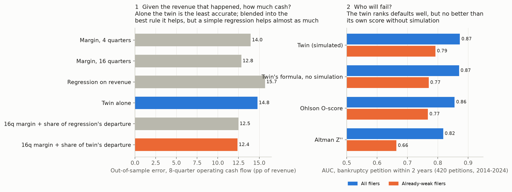

# FinTwin: a financial-health digital twin for public companies

[](https://github.com/SpiliosDimakopoulos/fintwin/actions/workflows/ci.yml)
[](https://github.com/SpiliosDimakopoulos/fintwin/actions/workflows/data.yml)


[](https://doi.org/10.5281/zenodo.23434606)
[](https://github.com/SpiliosDimakopoulos/fintwin/labels/good%20first%20issue)
[](https://github.com/SpiliosDimakopoulos/fintwin/discussions)

**[Live dashboard](https://spiliosdimakopoulos.github.io/fintwin/)** · **[Paper (PDF)](docs/paper/fintwin.pdf)** · [Methodology](docs/METHODOLOGY.md) · [Backtest report](docs/BACKTEST.md) · [Carnival case study](docs/CASE_STUDY_CCL.md)

**FinTwin builds a quarterly cash-and-debt model of each of 390+ US public companies from its SEC filings and runs Monte Carlo stress tests on it, in your browser.** It doesn't predict a stock price. It simulates how cash, debt, margins and credit quality respond to a pandemic, a rate shock or a closed bond market, and it reports a *distribution* of outcomes rather than a single number.


**Try it:** [Carnival under a pandemic](https://spiliosdimakopoulos.github.io/fintwin/#stress/CCL/pandemic) · [Carnival vs Royal Caribbean](https://spiliosdimakopoulos.github.io/fintwin/#versus/CCL/RCL) · [rewind Carnival to past years](https://spiliosdimakopoulos.github.io/fintwin/#time/CCL) · [all 390+ companies](https://spiliosdimakopoulos.github.io/fintwin/c/)

**Who it is for:** analysts and students who want to see how a company's cash and debt react to a shock, researchers who need a point-in-time, survivorship-free SEC panel with a look-ahead-safe backtest harness, and anyone who wants the numbers as plain JSON.

> **30-second pitch.** A flight simulator for corporate finance. It reads 15 years of a company's official filings and learns how its finances behave: fixed vs variable costs, how fast customers pay, when its debt matures. Then it replays the future 5,000 times under any crisis you pick, live in the browser. Then I tested it the hard way, under rules committed before the runs: on every US non-financial SEC filer with $50M+ revenue reporting in US GAAP, including the ones that went bust, against simple rules and statistical rivals that see the same data. Fixing the bugs a code review found cut its typical cash-flow error from 11.1 to 8.1 points of revenue, in every year. A 16-quarter cash-flow margin is still more accurate (6.7). Its departures from that margin help only a little, and only under mean loss. Its simulated distributions are far too narrow, and its liquidity-shortfall probabilities lose to a three-ratio logit. Treat it as a scenario calculator around a persistence forecast, not as a source of calibrated probabilities. It covers 390+ companies on the dashboard and rebuilds itself from the latest filings every week.

## Results



All numbers come from out-of-sample, point-in-time tests on a survivorship-free universe of **5,309 non-financial US-GAAP filers**: every company with $50M+ revenue in some year 2012-2024, including those later acquired, delisted or bankrupt. That is 21,171 firm-years 2014-2024, with a census of bankruptcy petitions (8-K Item 1.03, first filing of each case): **420 firm-years at 239 companies** are followed by one within two years. Every run reads one frozen data snapshot. The corrections, the specifications to report and the decision rules were committed before any code changed ([plan 3](docs/REVISION_PLAN_3.md)). The old specification (v2-pre) and the corrected one (v3) are reported side by side.

| Test | Result |
|---|---|
| **Corrections** (confirmatory: v3 vs v2-pre) | Median error of 8-quarter operating cash flow, given realized revenue: **8.1 vs 11.1** pp of revenue, lower in all 11 years. **Success.** But a few firm-years explode (47 above 1,000 pp, e.g. biotechs and cruise lines whose revenue jumped from almost nothing). The mean error is therefore worse, and these cases are reported, not tuned away. |
| **Transmission** (realized revenue given to the model and to six simple rules, 15,933 firm-years) | The 16-quarter margin is still the most accurate (**6.7** vs 8.1). The model now *under*-reacts to revenue: its response is 0.67 of the realized one, outside the pre-specified 0.8-1.25, so this criterion **fails**. Its departures from the margin pass the old encompassing rule (*t* = 8.4, firm × year), but only under squared/winsorized loss. Blending ~20% of them into the margin cuts the winsorized mean absolute error by **3.3%** (8/8 years); on raw errors the blend is worse. A model confidence set cannot separate it from the margin's other blends. |
| **Distributions** (CRPS/PIT vs Gaussian and empirical residuals) | **Fails.** The simulated 90% interval covers **30%** of outcomes: the distributions are far too narrow. |
| **Liquidity shortfall** (P(cash + undrawn revolver < 0) vs realized shortfalls, Brier) | **Fails.** Brier skill **−0.20** vs a logit on three opening ratios, in all 8 cells. The model separates firms as well as the logit but its probabilities are miscalibrated (93% of firm-years get < 10%). |
| **Bankruptcy** (petition within 8 quarters) | AUC **0.87** for the model's health score, **0.87** for its formula without simulation, 0.86 Ohlson, 0.82 Altman Z″. Simulation adds nothing to ranking. |
| **Downturns** (2015-16, 2020, 2022) | Given each industry's realized shock, the model's fragility is associated with abnormal cash burn (*t* = 2.0, 4.0, 4.6, industry-clustered). The shock is realized, so this is a decomposition, not a forecast. |
| **Forecasts and calibration** (S&P 500, 4 quarters) | Revenue CRPS 28% better than a seasonal random walk and 20% better than ETS. For cash the random walk is best. Conformal intervals restore average coverage, but not in the 2020 stress quarters (78% for revenue). |
| **Data** | 52/53-week fiscal calendars are read correctly, filings missing from the SEC's companyfacts API are read from their own XBRL, and both legs of a differenced quarter (such as Q4 = FY − 9M) come from the same vintage. Rating spreads and GDP are point-in-time. |

Where it fails, in the paper's own words ([docs/paper/fintwin.pdf](docs/paper/fintwin.pdf)):
- It is not an early-warning system: its ranking of firms is that of its own scoring formula.
- Even corrected, it is less accurate in levels than a long-window cash-flow margin, and a few of its forecasts explode when revenue jumps from almost nothing.
- Its predictive distributions and shortfall probabilities are not calibrated and lose to simple statistical rivals.
- Two of its four feedback loops have no measurable effect.
- Its transmission test conditions on eight reported quarters, which only 15% of the firm-years followed by a bankruptcy achieve.

## What it does

| | |
|---|---|
| **Point-in-time SEC data** | XBRL `companyfacts` with tag fallbacks, year-to-date de-cumulation, impairment-adjusted EBIT, and *filed-date* vintages that make backtests free of look-ahead bias. Every number links to its source filing. |
| **System-dynamics model** | 9 balance-sheet stocks, quarterly flows, first-order delays and 4 feedback loops: a leverage–spread spiral, a market-access cliff, cash conservation and delayed restructuring. |
| **Calibrated Monte Carlo** | Robust (MAD) volatilities, Student-t tails, demand–margin correlation, a Vasicek short rate, and a Markov recession regime with NBER base rates and company-specific GDP sensitivity. |
| **Stress tools** | 9 crisis presets, free sliders and 6 CFO levers. Reverse stress testing answers "how big a shock breaks it?". Tornado charts and Sobol global sensitivity (with bootstrap CIs) show what matters. |
| **Analyst notes** | A rule-based analyst turns each company's simulation into a credit-memo-style note: verdict, evidenced risks, buffers, scenario commentary, watch list. Every figure is taken from the simulation output, not generated as text. An optional LLM module writes freer prose from the same fact sheet and machine-checks its figures, if you supply your own key. |
| **Sector-adjusted health** | Leverage that would alarm a software company is normal for a utility. Coverage and leverage are scored against each GICS sector's own norms, which are estimated from the data, and a waterfall shows how each component moves the score. |
| **Time machine** | Rewind any company to what its twin said at every February since 2013, using only the filings that existed then, and see what actually happened next (`#time/CCL`). |
| **Compare** | Put two companies side by side (`#versus/CCL/RCL`), or scan the whole universe × 8 crises, filtered by sector. |
| **Dashboard** | Light and dark themes. The landing page runs a live Monte Carlo you can steer. There is a Ctrl K / ⌘K company switcher, a stress lab whose scenarios are shareable as links, peer context on every company, and keyboard shortcuts (press `?`). Everything runs client-side in a Web Worker, so no server is needed. |
| **Ask the twin** | Describe a crisis in plain English ("revenue falls 40% for a year and banks stop lending", "another 2008 for Carnival") and the stress lab sets it up and simulates it. Built-in rules work everywhere; an optional on-device language model (Qwen2.5 1.5B via WebLLM, no API key, nothing leaves the browser) handles free-form text. Language only chooses the scenario: model output is validated and clamped, and every number comes from the simulation. |
| **What changed this week** | Each Monday's rebuild is compared with the previous one: which companies' health moved by 5+ points, after which filing, and which part of the score (runway, coverage, leverage, solvency) drove it. Also as an RSS feed. |
| **Weekly rebuild** | Every Monday a GitHub Actions workflow pulls the newest SEC filings and FRED data, rebuilds all twins across 16 parallel runners, re-runs the validation and the time machine, checks Python–TypeScript parity, and redeploys. |

| | |
|---|---|
|  |  |
|  |  |

## Use the data

Every number on the site is a static JSON file, free to fetch with no key and refreshed every Monday:

| URL | Content |
|---|---|
| [`data/index.json`](https://spiliosdimakopoulos.github.io/fintwin/data/index.json) | every company: name, sector, latest quarter, health and breach probability under each scenario, plus the model's scenario and rating tables |
| `data/companies/<TICKER>.json`, e.g. [`CCL.json`](https://spiliosdimakopoulos.github.io/fintwin/data/companies/CCL.json) | quarterly history from the filings, calibrated parameters, scenario bands, reverse stress, tornado and Sobol results, data-quality report |
| [`data/changes.json`](https://spiliosdimakopoulos.github.io/fintwin/data/changes.json), [`feed.xml`](https://spiliosdimakopoulos.github.io/fintwin/data/feed.xml) | what moved this week, as JSON and RSS |

```python
import json, urllib.request
base = "https://spiliosdimakopoulos.github.io/fintwin/data/"
idx = json.load(urllib.request.urlopen(base + "index.json"))["companies"]
worst = sorted(idx.items(), key=lambda kv: kv[1]["matrix"]["base"]["health"])[:5]
print([(t, round(c["matrix"]["base"]["health"])) for t, c in worst])
```

The engine also installs straight from git: `pip install "git+https://github.com/SpiliosDimakopoulos/fintwin#subdirectory=engine"`.

## Run it

```bash
cp .env.example .env                       # SEC_USER_AGENT (required by SEC)
cd engine && uv sync --locked && uv run pytest -q   # CI badge above = current status; tests: balance-sheet identity (Hypothesis), offline XBRL end-to-end, 52/53-week calendars, point-in-time, the transmission nulls, CRPS...
bash scripts/full_pipeline.sh              # validation (~30k forecasts) + all snapshots + backtests (hours; CI shards it)
cd ../web && npm ci && npm test && npm run dev    # includes Python <-> TypeScript parity
```

Optional extras:
- `uv run python -m fintwin.notes` regenerates the analyst notes. The optional LLM memos need your own API key: `uv run --extra ai python -m fintwin.memo CCL`.
- `uv run --extra api python -m fintwin.api` lets you twin any ticker live.
- `uv run python scripts/paper_assets.py` regenerates the paper's figures and numbers.
- `uv run python scripts/research_assets.py` regenerates the evaluation tables, figures and number macros from `docs/paper/research.json`; `uv run python -m fintwin.research shard <i> <n>` and `... stats` produce that file.
- Reproducing the paper (frozen data snapshot, `make research`, `make paper`, the `paper-*` tag): see [REPRODUCE.md](REPRODUCE.md). Data sources and their terms: [LICENSE-DATA](LICENSE-DATA).
- Version: 3.0.0-dev. The released paper version is the `paper-*` tag, not `main`.

## Repository map

```
engine/fintwin/   data/ (EDGAR, facts, FRED) · model/ (stock-and-flow core, ratings) · stochastic/ (calibrate, shocks, MC)
                  scenarios/ (presets, reverse stress) · sensitivity/ (tornado, Sobol) · backtest/ (walk-forward, batch, scoring)
                  universe.py (S&P 500, sector norms) · pipeline.py (sharded weekly build) · export.py · notes.py · memo.py · api.py
web/src/          engine/ (TS port + parity tests) · views/ · charts/
docs/             paper/ (LaTeX + figures, numbers generated from data) · METHODOLOGY · BACKTEST · CASE_STUDY_CCL · CV_KIT
```

## Contributing

- Start with an issue labelled [`good first issue`](https://github.com/SpiliosDimakopoulos/fintwin/labels/good%20first%20issue) or [`help wanted`](https://github.com/SpiliosDimakopoulos/fintwin/labels/help%20wanted).
- See [ROADMAP.md](ROADMAP.md) for the open research questions and [CONTRIBUTING.md](CONTRIBUTING.md) for setup and PR guidelines.
- One-click dev environment: [](https://codespaces.new/SpiliosDimakopoulos/fintwin)
- Questions and ideas: [Discussions](https://github.com/SpiliosDimakopoulos/fintwin/discussions).

To cite FinTwin, use [CITATION.cff](CITATION.cff) or the [Zenodo DOI](https://doi.org/10.5281/zenodo.23434606).

*Data: SEC EDGAR XBRL, FRED. Rating table: A. Damodaran (Jan 2026). MIT licence. Not investment advice.*
